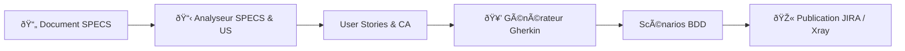

## 📑 Sommaire
* TOC
{:toc}

---

# Documentation MAX V6

Bienvenue sur la documentation officielle du projet **MAX V6** (Module d'Assistance eXpert).

MAX est une plateforme d'IA générative conçue pour accélérer et fiabiliser la chaîne de delivery agile : de l'analyse des spécifications fonctionnelles jusqu'à la publication des scénarios de test dans JIRA / Xray.

---

## 🚀 Accès rapide

-   :material-rocket-launch:{ .lg .middle } **[Démarrer en 5 minutes](guide/quick-start.md)**

    ---

    Prérequis, lancement du serveur, connexion et premiers tests en mode local ou connecté.

-   :material-presentation:{ .lg .middle } **[Présentation & Fonctionnalités](guide/presentation.md)**

    ---

    Découvrez les agents IA, les cas d'usage et la valeur ajoutée pour les équipes produit et QA.

-   :material-server-network:{ .lg .middle } **[Architecture technique](architecture/architecture.md)**

    ---

    Schémas d'architecture, microservices, ports réseau, flux de données et intégrations.

-   :material-cog:{ .lg .middle } **[Installation & Déploiement](guide/installation.md)**

    ---

    Guide complet pas-à-pas : proxy VS Code Copilot, Docker Compose et environnements d'hébergement.

---

## 🎯 Fonctionnalités clés de MAX V6

1. **📋 Analyseur de Spécifications et Générateur d'US** : Extraction automatique des exigences (`EF-xxx`), génération des User Stories avec critères d'acceptation détaillés.
2. **🥒 Générateur de tests Gherkin BDD** : Création automatique de fichiers Features et scénarios de tests BDD conformes ISTQB.
3. **🎫 Intégration JIRA / Xray** : Import direct depuis un ticket JIRA et publication automatisée des tests créés avec traçabilité.
4. **🔒 Respect de la confidentialité des données** : Fonctionnement via GitHub Copilot Proxy ou modèles d'entreprise sans fuite de données.

---

## 📦 Modules et composants

Explorez la documentation détaillée des composants du projet :

- **[Backend (back-max)](modules/backend.md)** : API REST, orchestration des agents, proxies d'appels.
- **[Frontend (front-max)](modules/frontend.md)** : Interface utilisateur unifiée, gestion de sessions.

